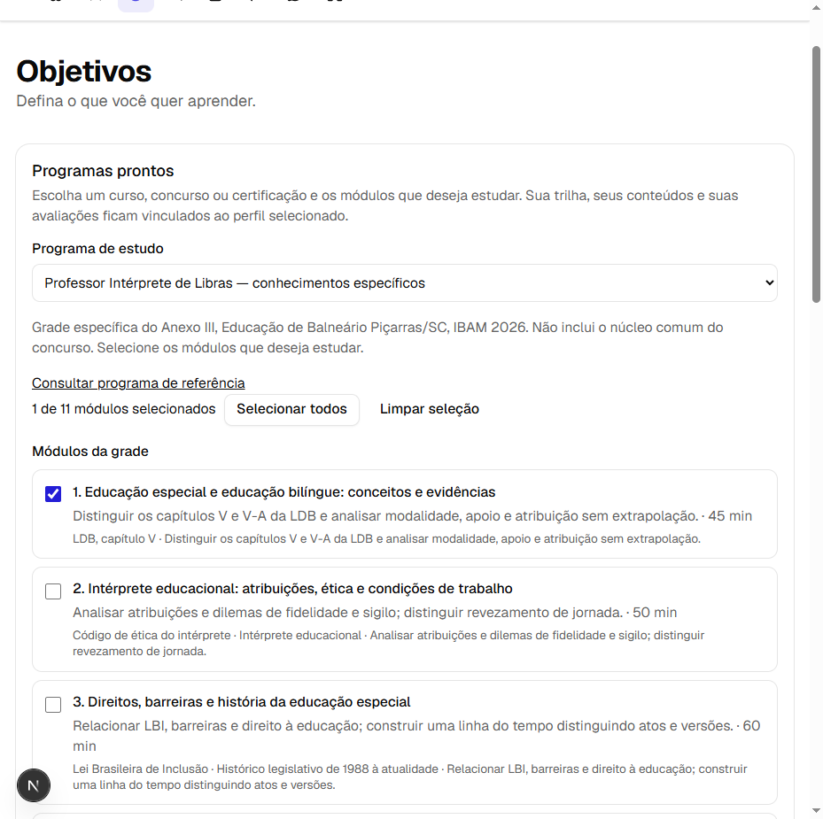
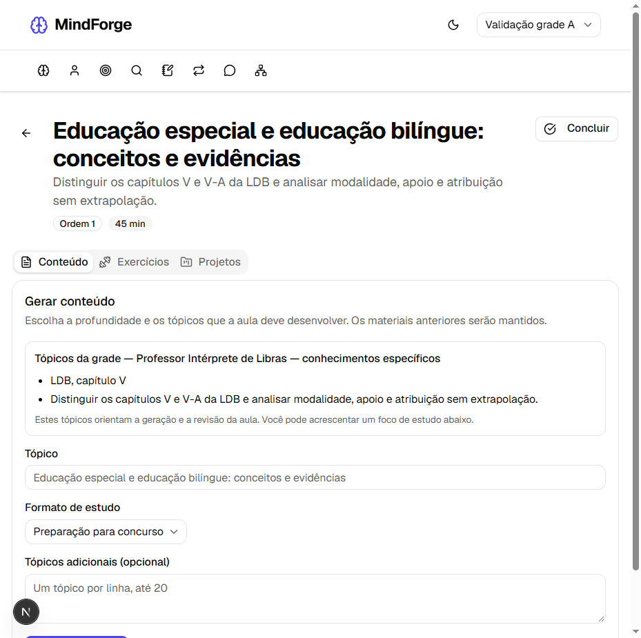
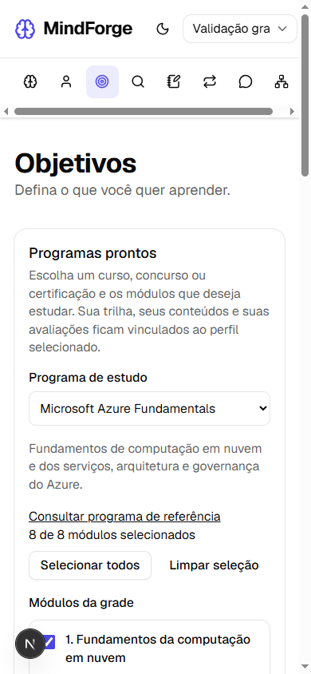

# Programas prontos dentro dos objetivos do perfil

Atualização local de 03/10/2026. O catálogo passa a fornecer uma grade para o estudante criar seu próprio objetivo e sua trilha. O concurso de Libras participa do mesmo fluxo usado por assuntos e certificações, como AZ-900.

## Como estudar

1. Selecione seu perfil na navegação e abra **Objetivos**.
2. Em **Programas prontos**, escolha um programa. A grade mostra módulos, objetivos de aprendizagem e tempo estimado.
3. Selecione todos os módulos ou apenas os que deseja estudar e clique em **Criar meu estudo**. Não é necessário escrever um título ou o programa do edital.
4. Clique em **Abrir minha trilha** e abra um módulo. A criação inicial grava a grade e as referências, sem instalar aulas ou provas previamente escritas.
5. Em **Gerar conteúdo**, confira os **Tópicos da grade**. Para concursos, o formato inicial é **Preparação para concurso**. Você pode adicionar um foco, outros tópicos ou escolher outro formato de estudo.
6. Gere os exercícios na aba **Exercícios**. Depois, crie um simulado na trilha. As questões objetivas continuam com alternativas selecionáveis e correção após finalizar a avaliação.

O formulário de objetivo livre continua disponível. Ele permite estudar assuntos que não estão no catálogo.

## Grade compartilhada e estudos por perfil

O catálogo é um modelo reutilizável. Cada criação recebe um objetivo, uma trilha, módulos e referências próprios, vinculados ao perfil informado. Conteúdos, exercícios, tentativas, avaliações e progresso seguem os vínculos já existentes no aplicativo.

A seleção usa posições originais de módulo, começando em 1. O backend valida índices, duplicações e existência do perfil antes de criar um programa. Objetivo, trilha, módulos e referências são gravados numa transação: uma falha nas referências reverte também as demais gravações.

Ao trocar de perfil, a escolha de programa e módulos ainda não enviada é reiniciada. Abrir um objetivo ou módulo pertencente ao perfil anterior mostra uma orientação para selecionar seu responsável, sem exibir as ações e materiais do estudo. Isso organiza os perfis de aprendizagem no aplicativo local; autenticação e autorização entre usuários continuam fora deste escopo.

## Escopo da geração e histórico

`trilhas_estudo.metadata.programa` contém o retrato da grade usada na criação. `metadata.modulosIndices` mantém as posições escolhidas, mesmo quando a trilha contém somente um módulo. Não foi necessária uma nova migration.

O módulo resolve seu escopo a partir desse retrato salvo. O Synthesizer e o Reviewer recebem os tópicos da grade, o objetivo do módulo e as referências associadas. O backend combina os tópicos obrigatórios com os adicionais do estudante; omiti-los no formulário não elimina a cobertura exigida. O gerador de exercícios também recebe o escopo escolhido.

**Regenerar trilha** preserva a seleção de módulos, usando o programa disponível no catálogo naquele momento. A versão anterior e seus materiais continuam no histórico; atualizações futuras no catálogo não reescrevem os retratos já salvos. A geração livre e o campo antigo `certificacaoCodigo` continuam compatíveis.

O item **Libras** saiu da navegação. `/estudo/libras` redireciona para `/objetivos`. Os estudos, fontes, exercícios e resultados instalados pelo percurso anterior permanecem em seus objetivos. A API anterior permanece por compatibilidade, mas não é usada na nova criação de programa. Não houve conversão ou exclusão automática de registros.

## Programas disponíveis

O catálogo contém Fundamentos de cibersegurança, Kali Linux em laboratório, Azure Fundamentals, AWS Cloud Practitioner, ISC2 CC e **Professor Intérprete de Libras — núcleo comum e conhecimentos específicos**.

A grade reúne os 19 assuntos específicos em 11 módulos e, após a ampliação de 03/10/2026, os núcleos comuns em mais 16 módulos: seis de Português, sete de Legislação e três de Raciocínio Lógico. Veja [o programa, as referências e como complementar estudos anteriores](26-nucleo-comum-concurso.md). Reaproveita as referências específicas conferidas anteriormente e registra o Anexo III como fonte do programa comum, com data de consulta. A composição de um simulado integral permanece pendente. As melhorias de profundidade, revisão por critérios e ilustrações continuam no gerador; imagens de gestos não substituem exemplos em vídeo de Libras com procedência.

## Verificação local

- API: 98 suítes e 768 testes aprovados, incluindo PostgreSQL isolado, perfis distintos, rollback, validação da seleção e contexto compartilhado entre gerador e reviewer. Cobertura: 93,61% de statements, 83,72% de branches, 87,01% de functions e 93,84% de lines.
- Frontend: 24 arquivos e 102 testes aprovados, incluindo seleção parcial, troca de perfil, redirecionamento, regeneração e alternativas da avaliação.
- Compilação e lint aprovados na API e no frontend.
- Navegador real: criação de uma trilha com um módulo no perfil A, formulário com tópicos da grade e modo de concurso, bloqueio visual após trocar para B, lista de objetivos de B vazia e grade Azure no celular (390 × 844, sem expansão da largura da página).
- Os testes de geração usaram respostas simuladas. Não foi feita uma nova avaliação pedagógica com saídas de um provedor externo, nem gerados estudos automaticamente no banco pessoal.

As capturas abaixo usam perfis descartáveis e um banco isolado. A infraestrutura de validação foi encerrada após os testes; o ambiente pessoal foi atualizado para visualização.

