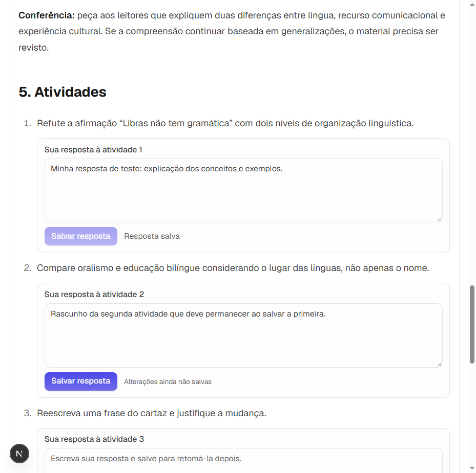

# Respostas às atividades da aula

Entrega local de 03/10/2026. As perguntas da seção **Atividades** eram apenas texto no Markdown: o estudante conseguia ler o enunciado, mas não registrar sua resposta dentro da aula.

Agora cada pergunta reconhecida possui um campo **Sua resposta à atividade** e o botão **Salvar resposta**, logo abaixo do enunciado. A confirmação **Resposta salva** indica a gravação no banco. Reabrir a aula recupera o texto; editar e salvar atualiza somente aquela resposta. Alterações ainda não salvas ficam sinalizadas. O salvamento de uma pergunta conserva os rascunhos das outras.

## Como usar

1. Selecione o perfil responsável pelo estudo e abra o módulo em Objetivos.
2. Na aula, localize a seção Atividades e escreva no campo abaixo da pergunta.
3. Clique em Salvar resposta. Aguarde a confirmação antes de sair ou recarregar a página.
4. Para complementar a resposta, altere o texto e salve novamente.

O recurso registra respostas abertas. Não atribui notas, não corrige por IA e não marca o módulo como concluído. Os critérios de resposta já presentes no material continuam disponíveis para conferência. Provas e exercícios extras possuem seus próprios fluxos.

## Compatibilidade e vínculo com o estudo

As aulas existentes não precisam ser regeneradas: o servidor reconhece listas numeradas ou com marcadores em seções Markdown cujo título começa com Atividade ou Atividades, inclusive `## 5. Atividades`. Cada item principal corresponde a uma pergunta. Subitens fazem parte do enunciado da atividade; listas em exemplos de código, comentários HTML e blocos `
` de critérios não criam campos.

Perguntas em parágrafos avulsos ou listas HTML não são convertidas automaticamente. Para novas aulas completas ou de concurso, o Synthesizer orienta uma seção `## Atividades`, lista numerada e critérios separados em `
`.

As respostas pertencem ao conteúdo e ao perfil proprietário do objetivo. A API confere a cadeia conteúdo → módulo → trilha → objetivo antes de consultar ou salvar, e obtém o enunciado do próprio conteúdo. A chave combina a posição da pergunta com seu enunciado. Outra versão de conteúdo mantém suas próprias respostas; elas não são transferidas para perguntas novas.

## Persistência e API

Migration aditiva: `mindforge-api/src/database/migrations/0017_respostas_atividades.sql`, aplicada e conferida no banco pessoal. Não modifica o Markdown nem respostas de exercícios. Tabela `respostas_atividades`:

| Campo | Finalidade |
|---|---|
| `conteudo_id` | Conteúdo da aula; FK com exclusão em cascata |
| `perfil_id` | Perfil responsável pelo estudo; FK com exclusão em cascata |
| `atividade_chave` | SHA-256 da posição e do enunciado |
| `enunciado` | Pergunta conferida pelo servidor |
| `resposta` | Texto de 1 a 10.000 caracteres, após remover espaços externos |
| `atualizado_em` | Data do último salvamento |

A chave primária composta evita duplicação ao editar. O upsert altera o texto e a data da resposta correspondente. A validação HTTP rejeita texto vazio, perfil inválido e campos extras. Perfil diferente recebe 403; conteúdo ou pergunta inexistente recebe 404. Trata-se do isolamento por perfil do aplicativo pessoal local, sem autenticação de usuário.

| Método e rota | Entrada e resultado |
|---|---|
| `GET /atividades-conteudo/conteudos/:conteudoId` | `perfilId` obrigatório na query; perguntas, posições e respostas salvas |
| `PUT /atividades-conteudo/conteudos/:conteudoId/:chave` | Body `{ perfilId, resposta }`; texto e data da resposta salva |

O frontend usa consultas TanStack Query separadas por conteúdo e perfil. O componente de item Markdown mantém sua identidade durante a atualização da consulta: isso impede que salvar uma resposta recrie os campos e apague outros rascunhos. Falhas de salvamento mantêm o texto disponível para nova tentativa.

## Validação realizada

- API: 102 suites, **781 testes aprovados**, incluindo PostgreSQL real isolado. Cobertura: statements 93,71%, branches 83,95%, functions 87,09% e lines 93,95%.
- Frontend: 25 arquivos, **106 testes aprovados**. Regressão específica para conservar o rascunho de outra atividade ao salvar.
- Builds de API e frontend e lint de ambos aprovados.
- Banco pessoal: 18 migrations aplicadas, tabela nova presente. API e frontend respondem 200; consulta das atividades de uma aula existente verificada sem gravar respostas de teste no banco pessoal.
- Navegador em ambiente isolado: as quatro perguntas da aula Libras/língua e cultura receberam campos; salvar, conservar outro rascunho, recarregar, editar e recarregar novamente conferidos. Tela de 390 px sem transbordamento dos campos. Nenhuma geração de IA foi necessária para essa validação.

Capturas do ambiente isolado:

[Visualização no celular](assets/atividades-conteudo/mobile.png).

O ambiente pessoal foi atualizado e permanece acessível em `http://localhost:3001`. Docker/PostgreSQL e Ollama foram preservados. Os processos temporários de validação são encerrados ao concluir a conferência.
