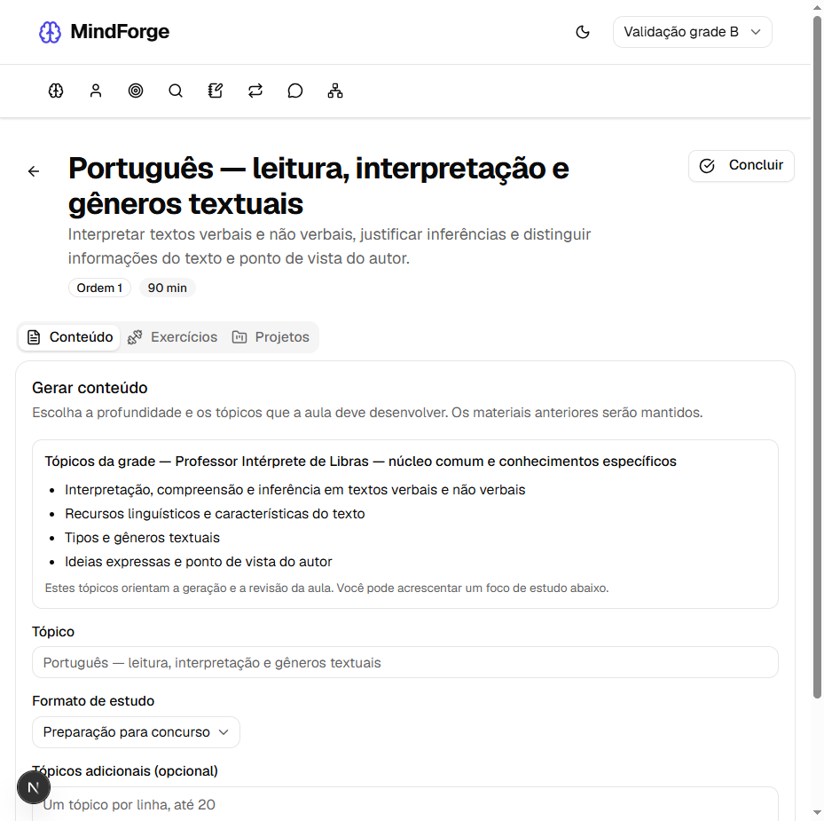

# Concurso Libras: Português e Legislação de nível superior

Atualização local de 03/10/2026. A grade de Professor Intérprete de Libras agora inclui o núcleo comum de nível superior do [Anexo III do processo seletivo 02/2026 de Educação de Balneário Piçarras](https://www.ibam-concursos.org.br/documento/an3.psedu26.pdf).

A página 1 apresenta Português e Legislação para funções de nível superior. Raciocínio Lógico também aparece no texto do bloco de Legislação e recebeu módulos próprios para organizar o estudo. Os conteúdos específicos de Professor Intérprete de Libras constam das páginas 5 e 6.

## Grade disponível

| Posições | Grupo | Módulos |
|---|---|---:|
| 1–11 | Conhecimentos específicos de Libras | 11 |
| 12–17 | Português para nível superior | 6 |
| 18–24 | Legislação para nível superior | 7 |
| 25–27 | Raciocínio Lógico do núcleo comum | 3 |
| **Total** | **Grade do concurso** | **27** |

### Português

1. Leitura, interpretação, compreensão e inferência em textos verbais e não verbais; recursos, características, tipos, gêneros, ideias e ponto de vista do autor.
2. Sentidos e emprego de palavras e expressões no contexto, coesão, coerência, funções e figuras de linguagem.
3. Classes gramaticais, formação de palavras, prefixos, sufixos e flexão de nomes e verbos.
4. Termos sintáticos da oração, emprego e colocação dos pronomes átonos e concordância nominal e verbal.
5. Transitividade, regência nominal e verbal e crase.
6. Pontuação, acentuação gráfica, porquês e ortografia.

Esse grupo trata da língua portuguesa exigida no núcleo comum. É distinto do módulo específico de ensino de Português escrito como L2 para surdos.

### Legislação

1. Constituição Federal, Títulos I, II e III, e princípios da Administração Pública.
2. Lei de Acesso à Informação, Lei 12.527/2011, e Lei de Improbidade Administrativa, Lei 8.429/1992.
3. Lei Orgânica de Balneário Piçarras e LC municipal 87/2013, Sistema Municipal de Ensino.
4. LDB, Lei 9.394/1996 e alterações, no escopo geral do núcleo comum, além do capítulo V já tratado nos específicos.
5. Resolução CNE/CEB 4/2010 e BNCC.
6. Política Nacional de Educação Especial na Perspectiva da Educação Inclusiva, distinguindo o documento indicado dos marcos posteriores.
7. Estatuto da Criança e do Adolescente, Lei 8.069/1990.

### Raciocínio Lógico

1. Operações com inteiros e racionais em forma decimal e fracionária, porcentagem, regra de três simples e composta, razão e proporção.
2. Medidas de tempo, massa, comprimento, superfície, volume e capacidade; gráficos, tabelas e média aritmética simples.
3. Operações e problemas com conjuntos e resolução de situações-problema.

## Como iniciar ou complementar o estudo

Em **Objetivos → Programas prontos**, selecione **Professor Intérprete de Libras — núcleo comum e conhecimentos específicos**. Os 27 módulos são inicialmente selecionados; é possível limpar a seleção e escolher apenas os assuntos desejados.

Para quem já possui uma trilha com os específicos, selecione somente os módulos 12–27 e crie um estudo complementar no mesmo perfil. A trilha anterior, suas aulas, respostas e resultados continuam disponíveis. A atualização do catálogo não acrescenta módulos automaticamente aos objetivos existentes. Regenerar uma trilha preserva os índices selecionados anteriormente.

Após criar a grade, abra cada módulo e gere seu conteúdo. Os tópicos obrigatórios seguem o escopo daquele módulo; todos os assuntos não são comprimidos em uma única aula. O modo inicial continua **Preparação para concurso**, com explicações, atividades, exemplos e revisão. O aluno pode acrescentar um foco sem eliminar os tópicos do programa.

## Implementação e referências

`planner/trilhas-guiadas/nucleo-comum-educacao.ts` organiza os 16 novos módulos, seus objetivos, tempos estimados, tópicos e referências. `concurso-libras.ts` incorpora esses módulos depois dos 11 específicos. Essa ordem preserva o significado de seleções antigas. Os tempos são estimativas didáticas, sem atribuição de pesos ou frequência de cobrança à banca.

Cada novo módulo registra o Anexo III, seção e página 1, com data de consulta. Essa fonte comprova **quais assuntos estão no edital**; não comprova o conteúdo nem a vigência das normas. Os objetivos de Legislação orientam consulta aos textos oficiais e identificação de alterações, inclusive dos atos municipais. Não foram inventados dispositivos locais ou trechos legais para preencher referências ausentes.

A criação transacional existente grava módulos e fontes próprios de cada perfil. O retrato da grade e a seleção ficam na metadata da trilha. O mesmo escopo alimenta Synthesizer, Reviewer e gerador de exercícios. Não foi necessária migration nem conversão de registros pessoais. Novas aulas e questões são geradas pelas ações do estudante.

## Validação

- API: **103 suites e 787 testes aprovados**, incluindo PostgreSQL isolado; cobertura 93,72% statements, 83,95% branches, 87,12% functions e 93,96% lines.
- Testes de cobertura do programa: todos os assuntos comuns, preservação das posições 1–11 e tópicos recebidos pelo gerador/reviewer com foco adicional.
- PostgreSQL real: criação integral de 27 módulos e seleção parcial de Português, Legislação municipal e Raciocínio Lógico; referências, escopo, isolamento por perfil e preservação de estudo anterior.
- Build e lint da API aprovados. A interface existente consome o catálogo atualizado; não foram alterados arquivos do frontend.
- API pessoal atualizada; catálogo com seis programas e 27 módulos no concurso, frontend HTTP 200 e respostas de atividades existentes disponíveis. PostgreSQL, Ollama e dados pessoais preservados.
- Navegador isolado: seleção inicial de 27 módulos, criação parcial com Português, LDB e conjuntos e formulário do módulo de Português com os tópicos obrigatórios e modo concurso. Não houve geração por provedor nem gravação de estudo de teste no banco pessoal.

O anexo orienta o conteúdo programático. Esta atualização não certifica domínio dos assuntos, aprovação ou correspondência das questões autorais com a prova oficial. A composição de um simulado integral e a conferência pedagógica de novas respostas dos provedores continuam etapas distintas.

Capturas do ambiente isolado:

[Trilha criada com três módulos comuns selecionados](assets/nucleo-comum/trilha-parcial.png).
